Dawsome's Help guide: the Help window (F1, or the Help button at the toolbar's right end) shows
it, a section a page. For whoever edits it: every sentence states what the program does now,
checked against docs/manual.md, crates/app/src/ui/hint.rs and the code. Write it warm and plain: second
person, short sentences, one idea to a sentence, and the parts called what the app calls them (the
main window, the toolbar, the Library, the Channel rack, the Playlist, the piano roll, the Mixer,
Settings). A line `# ` starts a section, `## ` a heading, `- ` a point, `` a
picture of this folder (made by scripts/help-shots.sh), `**words**` bold. Nothing above the first
section is shown.

# What Dawsome does
Dawsome is a program for making music on your computer: a digital audio workstation, or DAW. You
don't need to read music or play an instrument to use it. If you can click a mouse and hum a tune,
you can make a song here.

## How a song comes together
You make short loops called patterns, then lay them out one after another to build a song:
- **Pick your sounds.** Drums, a bass, a piano. Each sound gets its own row in the **Channel
  rack**.
- **Make a pattern.** Click in a beat, or draw the notes of a tune.
- **Arrange it.** Lay your patterns along the **Playlist**, as many times as you like.
- **Mix and share.** Balance your sounds in the **Mixer**, then save the song, or export it as a
  sound file anyone can play.

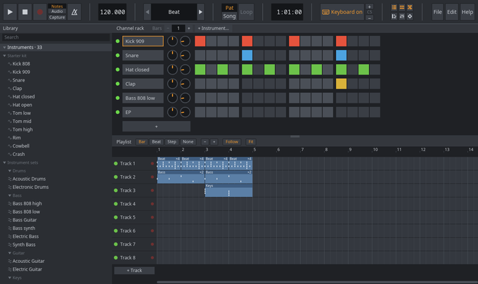

## You can't break anything
Every change can be taken back. **Ctrl+Z** undoes the last thing you did, up to 500 steps back,
and **Ctrl+Shift+Z** brings it back again. So try things freely. That's how you find the sounds
you like.

## Where to start
New to making music? Start with **A quick tune in ten minutes**. It takes you from an empty
project to a finished file, one click at a time. **A melody, step by step** and **From loop to
song** go further. The pages in between explain each part of the main window, for whenever you
want to know more.

## Opening this guide
Open this guide any time with the **Help** button at the right end of the toolbar, or with
**F1**. Press either again, or Esc, to close it.

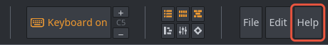

# The main window
The main window is where you make your music. It's made of panels, one for each kind of job. You
open the ones you need and close the rest.

## The panels
Each panel has a key that opens it, and the same key hides it again:
- **Library** (**5** or **F8**): your sounds, instruments and MIDI devices, down the left side.
- **Channel rack** (**1** or **F6**): a row for each sound, with a grid of steps for clicking in a
  beat.
- **Playlist** (**2** or **F5**): the tracks where you lay out your patterns, left to right in
  time.
- **Piano roll** (**3** or **F7**): a grid of notes, for melodies, bass lines and chords.
- **Mixer** (**4** or **F9**): where you balance your sounds and add effects.
- **Settings** (**6** or **F10**, or **Edit → Settings…**): a window of its own, for your
  speakers, your MIDI keyboard and the keys.

The six small buttons near the right end of the toolbar open and close the panels too. The lit
ones are open.

## Making room
The panels on the right are stacked, and they share the window's height. To give one more room,
drag the line between two of them up or down. Double-click the line to reset them.

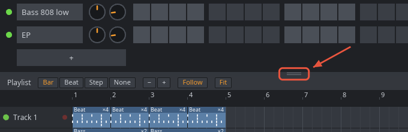

## The toolbar
The toolbar runs across the top of the main window. On its left are the controls for playing:
**Play**, **Stop**, **Record** and the metronome. **Space** plays and stops too, so you rarely
need the mouse for it. Next come the tempo, the pattern box, **Pat** and **Song**, and **Loop**.
Further along, the position counts bar : step : tick as the song plays, and a switch lets your
computer keyboard play notes. The panel buttons, the **File** and **Edit** menus and **Help** sit
at the right end.

The tempo is your song's speed, in beats per minute (BPM). Drag it up or down, scroll over it, or
click it and type a number. **Stop** takes you back to where the song plays from.

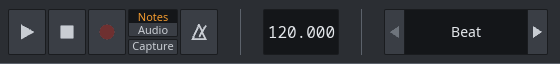

## The hint bar
The line at the bottom of the window tells you about whatever is under the mouse: its name, its
value, and what a click or a drag does to it. Whenever you're not sure what something is, point at
it and read the hint bar. You can switch it off and on in Settings, under **Hints**.

## Speakers or headphones
To choose where the sound goes, open Settings (**6**) and look under **Audio output**. It lists
each place by the name your system gives it, such as your headphones or your speakers. **System
default** follows whatever you chose in your system's sound settings.
- Click one, and the sound moves there at once. The line under the list says what is playing now.
- If it can't be opened, that line says why, and the sound stays where it was.
- While you're recording a take, the change waits for the next time you press Play.

# Adding an instrument
An instrument is anything that makes a sound when it gets a note: a drum sample, a piano, a
synthesizer. In Dawsome, each instrument is a channel, with its own row in the Channel rack.

## From the Library
Open the Library (**5**) and look under **Instruments**. You'll find three kinds of sound there.

**Starter kit** holds twelve drums made for Dawsome: 808 and 909 kicks, a snare, a clap, closed
and open hi-hats, three toms, a rim, a cowbell and a crash. A new project starts with four of them
already in the rack: Kick 909, Snare, Hat closed and Clap.

**Instrument sets** are instruments with a recording for each part of the keyboard, so they sound
right wherever you play them: a piano, basses, guitars, an organ, pads, strings, a marimba, drum
kits and more, grouped by kind.

**Plugins** lists the CLAP and VST® 3 plugins on your computer, such as Surge XT, a synthesizer
that comes with Dawsome. A VST3 one says VST3 at the end of its row.

To try a sound and add it:
- Click a sound or a set once to hear a short preview.
- Double-click it (or press **Enter**) to add it to the rack.
- Right-click it to add it and open its instrument window straight away.
- Or drag it onto the rack, or onto a track of the Playlist.

The search box at the top of the Library finds a sound by its name. In the rack, **+
Instrument…** at the top, or **+** under the last row, offers the same sounds as a list.

## Your own sounds
Any sound file of your own (a WAV, FLAC, Ogg, MP3 or AIFF file) can be a channel too. In the
Library, under **Samples**, click **+ Add folder…** to add a folder of your sounds. Click a file
to hear it. Drag it onto the rack to make a new channel, or onto a channel's row to have that
channel play it instead. **Change sample…**, in a channel's right-click menu, picks a file too.

You can also drop a sound file from your file manager straight onto a playlist track. It lands
where you let go of it, at the start of the bar, beat or step chosen at the top of the playlist,
as a new channel that plays it. Below the last track it gets a track of its own; several files
dropped at once go on the tracks one under another. On a Wayland desktop the window does not take
files from other programs yet: add their folder to the Library and drag them from there.

## The instrument window
Click a channel's name in the rack to select it. Double-click the name to open its instrument
window, where you shape how that channel sounds. For a plugin channel, the double-click opens the
plugin's own window instead, and its instrument window is in the name's right-click menu.

You don't need any of these controls to make music. When you do want to change a sound, here's
what each one does:
- **One-shot** plays the whole sound for every note; **Hold** stops it when the note ends.
- **Tune** and **Fine** change the pitch, in semitones and in smaller steps.
- **Attack** sets how fast the sound starts, and **Release** how long it rings on after the note
  ends.
- **Filter**: switch it **On** to take away what is above the **Cutoff**. **Reso** (resonance)
  makes that edge ring.
- **Velocity** sets how much louder the sound gets when you play harder. **Pan** places it from
  left to right, and **Volume** sets how loud it is.
- **Out** chooses the mixer insert it plays into.
- **Bend** sets how far a MIDI keyboard's pitch wheel bends the notes: 2 semitones, unless you
  change it.

Drag a control up or down to change it (hold Shift to go slowly), and double-click it to put it
back. Click a key along the bottom to hear the sound; lower on the key plays louder. Esc closes the
window.

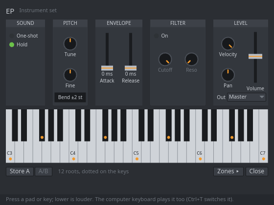

## Which keys a sound lives on
Dawsome calls middle C **C5**. Some programs call it C4, so the same key may have another name
elsewhere. A drum sounds much the same on any key, but a pitched sound plays higher on higher
keys. A bass line usually sits about two octaves below middle C, around **C3**. An 808 bass sits
lowest of all, between **C2** and **C3** (C1 to C2 where middle C is called C4).

The 808s play one note at a time, so each new note cuts off the one before. Any sample or
instrument set can do the same: tick **One note at a time** in its right-click menu in the rack.

# Editing a sound
A sound file can be shaped without changing the file itself: cut away what you do not need, fade
it in or out, make it louder or quieter, or play it backwards. Dawsome keeps your changes in the
project and plays the file through them; the file on your disk stays as it was.

## Opening the sample editor
Double-click an audio clip in the Playlist, or choose **Edit sample…** in a channel's right-click
menu or at the foot of its instrument window. It opens for the channels that play a sound file:
samplers and audio channels. Opened from a clip, it shows the part of the sound that clip plays,
marked along the top in the color of the clip's waveform. The clip's stretch settings open in
the Playlist as well, as a double-click always did.

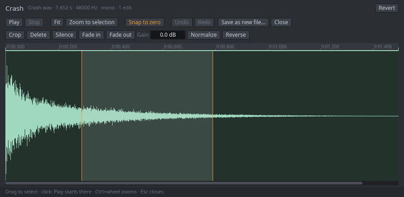

## Choosing a part
- Drag across the waveform to select a part.
- Click where **Play** should start. Shift+click stretches the selection to the click.
- Double-click, or press **Ctrl+A**, to select the whole sound.
- Ctrl+wheel zooms in and out around the pointer, and the wheel scrolls. **Fit** shows the whole
  sound again; **Zoom to selection** fills the window with the part you chose.
- **Snap to zero** moves the edges of a selection to where the wave crosses zero, so a cut does
  not click. It stays lit until you switch it off.
- **Play** (or Space) lets you hear what you are about to change: the selection, or from where
  you clicked to the end. **Stop** stops it.
- Esc clears the selection; pressed again, it closes the window.

## Changing it
- **Crop** keeps only the selection.
- **Delete** (or the Delete key) takes it out and closes the gap.
- **Silence** makes it quiet without changing the length.
- **Fade in** rises from silence, and **Fade out** falls to it.
- **Gain**: drag the box up to make it louder or down to make it quieter, then let go.
- **Normalize** makes it as loud as it can be, its loudest point at 0 dB.
- **Reverse** plays it backwards.

With nothing selected, a change applies to the whole sound; Crop and Delete need a selection.
Each change is one step of Undo, and **Revert** takes the sound back to the file in one step.
Every clip of that channel plays the changed sound. When you crop or delete a part before a
clip's place in the sound, the clip moves with it and keeps playing what it played.

If the file on your disk changes after you edit it (it is longer or shorter now), the editor
says so at the top. Your changes still apply.

## Keeping a copy as a file
**Save as new file…** writes the sound as you hear it to a new WAV file, named after the file
with "(edited)" added, where your recordings go: the **samples** folder beside your project. The
Library shows it there. Your original file is never changed. A long sound takes a moment: the
button says **Saving…** until it is done.

# Playing notes
You can play an instrument live, on your computer's keyboard or on a MIDI keyboard. Whatever you
play goes to the selected channel: the one whose name you last clicked in the Channel rack, or
the one you just added.

## The computer keyboard
While the toolbar says **Keyboard on** (it does when you start), your letter keys play notes, laid
out like a piano:
- **A S D F G H J K L ; '** are the white keys, from middle C (C5) on **A**.
- **W E T Y U O P** are the black keys between them.
- **Z** and **X** move down or up an octave. The toolbar shows the octave between + and −.
- **C** and **V** play softer or louder (the velocity, from 20 to 127; it starts at 100).
- Hold **Tab** to sustain: the notes you let go of ring on until you let go of Tab.
- **Backspace** stops every note.

While the keyboard plays notes, a letter's shortcut needs Shift: **Shift+L** switches between
pattern and song mode, and **Shift+R** arms Record. **Space**, the digits **1** to **6** and the
function keys work as usual. Press **Ctrl+T**, or click the switch, to stop the keyboard playing
notes. The **Keys** page in Settings draws what each key does, and offers an older layout of two
rows.

## A MIDI keyboard
A MIDI keyboard is a piano-style keyboard that plugs into your computer, usually by USB.
- Plug it in, then open Settings (**6**) and tick it under **MIDI input** (or tick **All
  ports**).
- It shows up in the Library under **MIDI devices**, ticked. Its light blinks as you play, and
  the words after the arrow say which channel it plays.
- It plays the selected channel. To keep it on one channel whatever is selected, drag it from the
  Library onto that channel's row in the rack. Right-click it in the Library to unlink it again.
- Its sustain pedal holds the notes you let go of until you lift it.
- Its pitch-bend wheel bends the notes you play: 2 semitones up and down, or up to 24 with the
  instrument window's **Bend**.
- Its mod wheel opens the channel's filter when the filter is on, and adds a vibrato when it's
  off.

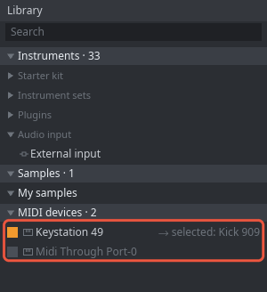

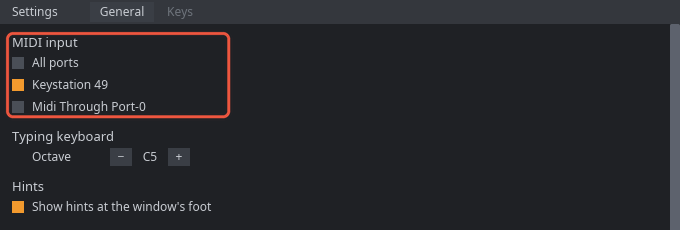

## An instrument cabled in
A synthesizer or another instrument cabled into your audio interface can play through Dawsome
too. In the Library, under **Instruments** and **Audio input**, double-click **External input**:
a new channel plays that input live. Double-click its name to choose the device and its inputs in
its window. You hear it a few milliseconds late, and its window says by how much.

# Patterns and the playlist
A pattern is a short loop of notes for any of your channels: a beat, a bass line, some chords. The
Playlist is where you lay patterns out in time, on tracks, to make a song.

## Making a pattern
The pattern box in the toolbar shows the pattern you're working on. Its arrows step to the pattern
before or after it, and the arrow past the last one makes a new, empty pattern. Right-click the
name to rename the pattern or delete it.

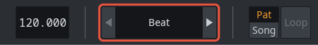

In the Channel rack, each row has 16 steps to a bar. Click a step to switch it on, and that
channel plays on that step. **Bars −** and **+** at the top of the rack make the pattern shorter
or longer, from 1 to 32 bars. For melodies, the piano roll is easier (see **The piano roll**).

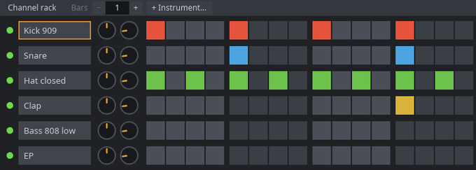

A good habit: give each part of your song its own pattern, such as "Beat", "Bass" and "Chords".
Then each part can have its own track, and you can bring it in or leave it out wherever you like.

## Pattern mode and song mode
**Pat** plays the pattern in the pattern box over and over, so you can work on it. **Song** plays
the Playlist from left to right. Press **L** to switch between them (**Shift+L** while the
keyboard plays notes).

## Laying out a song
- Click an empty place on a track, and the pattern in the pattern box lands there as a clip.
- Drag a clip to move it. Drag its right edge to make it longer or shorter.
- Right-click a clip to delete it. Shift+right-click mutes it.
- Click a clip to select it, and Shift+click to add more. Ctrl+drag over an empty place selects
  with a box. **Ctrl+B** copies the selection to just after itself, and **Delete** removes it.
- Click the numbers along the top to choose where the song plays from.
- **+ Track**, under the last track, adds a track. Right-click a track's name to rename it or
  delete it.

## Stretching and trimming a clip
Drag an audio clip's right edge to trim it: shorter cuts the end off, longer adds silence after
the sound. To stretch the sound to the new length instead, hold **Alt** while you drag the right
edge: the sound fills the clip, keeping its pitch unless the clip is set to Resample. Drag the
left edge to trim the start.

Double-click the clip for its stretch settings at the top of the Playlist: **Stretch** keeps the
pitch and gives a **Pitch** of its own, **Resample** plays faster or slower with the pitch moving
too, and **None** plays the file as it is; **Length** says how long it plays next to its file. The
same double-click opens the sample editor, whose **Reverse** plays the sound backwards. For a
sound in a sampler channel, played by notes, **Reverse** and **Start** in its instrument window
play it backwards or from further in.

## Linked clips
Every clip of one pattern plays that same pattern: the clips are linked. Change the pattern once
(a step, a note) and every clip of it changes too. A clip whose pattern plays in more than one
place shows **×N** at its right end, where N is the number of places.

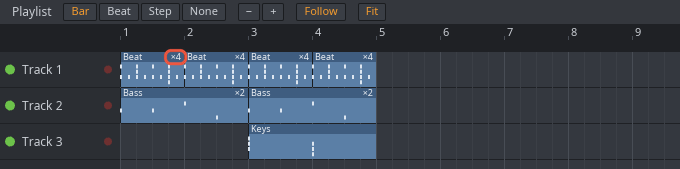

To change one clip on its own, unlink it. Select it, then click the chain right of **Fit** at the
top of the Playlist. The clip gets its own copy of the pattern, named like "Beat (copy)", and the
chain shows crossed out. Click the crossed chain to link the clip back. Ctrl+right-click on a clip
offers the same: **Unlink (make unique)** and **Link back to …** the pattern it was copied from.

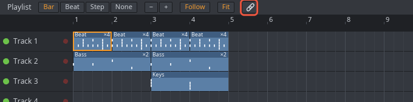

## The loop
To hear one stretch of the song over and over, drag along the thin strip under the Playlist's
numbers. While **Loop** is lit, the song plays that stretch again and again. Drag its ends to
change it, or right-click it to remove it.

# The piano roll
The piano roll is where you write melodies, bass lines and chords. It shows one channel's notes in
one pattern. Time runs from left to right, and each row is a key, as the piano down its left edge
shows.

## Opening it
- Double-click a pattern clip in the Playlist, and the piano roll opens on that clip's pattern.
- Or press **3** (or **F7**). It shows the pattern in the pattern box, for the selected channel.
- While it's open, click another channel's name in the rack, and it switches to that channel.
- Click a key on the left to hear it.

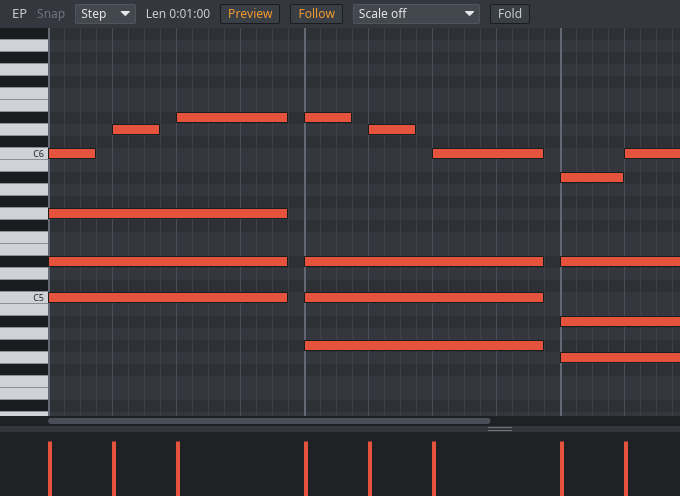

## Writing notes
- Click an empty place to draw a note there. Hold **Alt** to place it off the grid.
- A new note is as long as the last note you clicked or resized. **Len**, at the top, shows how
  long that is.
- Drag a note to move it, and drag its right edge to make it longer or shorter.
- Double-click a note to delete it, or select it and press **Delete**.
- Click a note to select it, Shift+click to add more, or drag over an empty place to select with
  a box. **Ctrl+A** selects them all.
- **Up** and **Down** move the selected notes a semitone (with Shift, an octave). **Left** and
  **Right** move them along by the snap.
- **Ctrl+C**, **Ctrl+X** and **Ctrl+V** copy, cut and paste notes, even into another pattern or
  onto another channel. **Ctrl+B** duplicates them.
- **Snap**, at the top, says what notes land on as you draw and move them: a step, a beat, a bar.

These keys work on the piano roll after you click in it, or while the mouse is over it with notes
selected.

## Velocity
Velocity is how hard a note is played, which usually means how loud it sounds. The lane under the
grid has a stem for each note. Drag a stem up or down, or drag across several to paint them. Hold
Alt and drag to draw a ramp. Drag the line above the lane to make the lane taller.

## The Notes menu
Right-click the grid, or click **Notes** at the top, for Cut, Copy, Paste, Duplicate and Delete,
and for these changes:
- **Quantize…** moves the notes toward a grid, as far as you choose, so they land on time.
- **Chop at snap** cuts the notes at every snap line.
- **Glue** joins touching notes of one key.
- **Legato** makes each note last until the next one starts.
- **Reverse** and **Invert** flip the notes in time, or turn them upside down in pitch.
- **Humanize** moves the notes and their velocities a little at random, so they sound less stiff.

These change the selected notes, or all of them when none is selected.

## Scales and more
- **Scale** shades the keys outside a scale darker, so you can stay in key. Choose a scale in the
  menu that says **Scale off**, then choose the note it starts on in the menu that appears beside
  it.
- **Fold** shows only the rows with notes and, with a scale, the scale's keys.
- **Preview**, lit when you start, plays notes as you draw and move them.
- **Follow** turns the page as the song plays past the view.
- The notes you play live, on the computer keyboard or a MIDI keyboard, show on the grid as they
  sound.

# Recording
Recording keeps what you play. Dawsome can record notes (which keys you pressed and how hard, so
you can still edit them afterwards) or audio (the sound itself, kept as a sound file).

## Recording notes
- Check that **Notes** is lit beside **Record**.
- Click **Record** (or press **R**) to arm it.
- Press **Play**. A bar of clicks counts you in, then you play.
- In pattern mode the pattern loops, and each pass adds the notes you play. Delete notes first if
  you want to replace them.
- In song mode your notes go into a new pattern named after the channel, such as "Kick take 1",
  and its clip grows by whole bars as you play.
- Press **Stop** when you're done. A whole take is one step of Undo, so you can always try again.

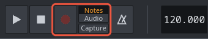

## Recording audio
Click **Audio** beside Record first. An audio take records what you hear (the master), or the
line in: the selected external input channel's device, or else your default input. Right-click
**Audio** to choose which. In pattern mode it records one pass of the pattern; in song mode, until
you press Stop. The take is kept as a sound file, "<project> take N.wav", and laid on the Playlist
as a clip, starting where the song plays from. Its channel sits under **Recordings** in the rack,
and its file is in the Library under Recordings.

## Count-in, Capture and the metronome
- **Ctrl+P**, or **Count-in** in Record's right-click menu, switches the bar of clicks before a
  take on and off.
- **Capture** (or **Ctrl+Shift+R**) turns what you played in the last 30 seconds into notes, even
  though you weren't recording. Played something good by accident? Capture it.
- The metronome's button plays a click on every beat while the song plays, the first of each bar
  louder. It is never recorded.

## Taking the line in on time
An audio take of the line in lands a little late, by the time your audio interface takes. To
correct that once and for all, loop a cable from the interface's output into its input, open
Settings, and press **Measure** under **Input latency**. From then on, those takes land on time.

# The mixer and effects
The mixer is where all your sounds meet before they reach your speakers. Here you balance them,
shape them and add effects to each one, without changing a single note.

## What a mixer is for
Picture the sound desk at a concert. Every instrument has its own strip, with its own volume
fader, and every strip feeds one main output. In Dawsome the strips are called inserts, and the
main output is the **master**, the strip on the far left. The master is what you hear, and what
an export puts in the file.

A new channel plays straight into the master, which is fine while you sketch. When you want to
work on one sound by itself, give it an insert of its own.

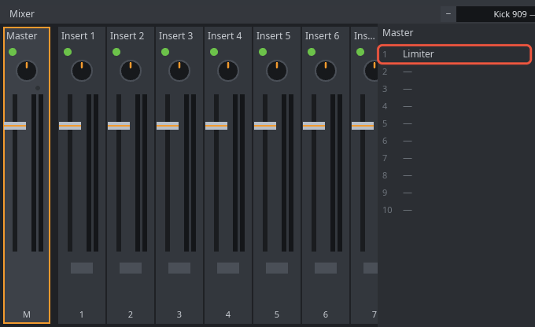

## A first routine
Try this with one sound, such as your kick. Then do the same for the others.
- **Give it a strip.** Right-click the channel's name in the rack and choose **Mixer insert…**.
  The channel gets an insert of its own, the first one nothing else uses, and the mixer opens on
  it: the box at the top of the mixer says "Kick 909 → Insert 1", and Insert 1 is selected. Do the
  same for the snare and it gets Insert 2. (The **+** beside the box moves the selected channel
  one insert along, and **−** one back.)
- **Name the strip.** Double-click the name at the top of the strip, type "Kick" and press Enter.
  A named strip is easy to find later.
- **Shape it with EQ.** The panel on the mixer's right shows the selected strip's ten effect
  slots. Click the first empty slot and choose **EQ**. Its settings appear under the slots. Raise
  **Low gain** a few dB for a fuller kick. On a piano or a pad, try lowering it instead, so it
  leaves room for the bass.
- **Check the master.** Click the master strip. Its first slot already holds the **Limiter**.
  Leave it there: it keeps the loudest moments from distorting.
- **Balance with the faders.** Play the song. Choose the part that matters most, often the kick
  or the melody, and leave its fader alone. Then move each of the other faders until it sits
  well beside that part.

You can also choose a channel's insert with **Out** in its instrument window, whose list ends
with **Mixer insert…** too, or select an insert and press **Ctrl+L** to play the selected channel
into it.

## When to touch a fader
- Touch a fader when one part is too loud or too quiet next to the others. Move it a little, then
  listen again.
- When everything is too quiet, turn up your speakers, not the faders. Pushing every fader up only
  makes the Limiter work harder.
- Leave the master's own fader where it starts. It comes after the Limiter, so pushing it up can
  still distort.
- Double-click a fader to put it back where it started.

## Reading a strip
- The fader sets the strip's volume. Drag it, and hold Shift to move it finely.
- The knob above it pans the sound left or right. Double-click it to center it.
- Click the light at a strip's top to mute it. Right-click the light to solo the strip, so you
  hear it alone.
- The master's small clip light, above its meters, comes on when the sound went past the top. It
  stays on until you click it.

## Effects
An effect changes the sound that passes through it. Each insert has ten slots, and the sound goes
through them from top to bottom. Click an empty slot to add one:
- **EQ** turns the lows, middles and highs up or down. Reach for it first.
- **Compressor (Pressure4)** evens out the loud and quiet moments, so a part sits steadily.
- **Saturator (Density)** adds warmth and grit.
- **Delay** repeats the sound as an echo, in milliseconds or in time with the tempo.
- **Reverb** adds the sound of a room.
- **Limiter** keeps the peaks under a ceiling.

Plugin effects, CLAP or VST3, go in the same slots. Click a full slot to show its settings, and
right-click it to remove it or move it.

## Sharing one reverb with a send
A send passes some of a strip's sound to another strip as well. It's the usual way to put several
sounds in the same room.
- Put a **Reverb** on a spare insert, name it "Room", and turn the reverb's **Mix** all the way
  up. The dry sound still comes through the strips that send to it.
- Select a strip you want in the room. Click the send button under the Room strip's fader, then
  drag the knob under that button to set how much goes there.
- A send that would make a loop is refused.

## Why the master has a Limiter
A sound file, and your speakers, can only hold sound up to a certain level. Anything louder is
clipped: its peaks are cut flat, and it sounds harsh and crackly. A chord, or a drum hit over a
bass, adds up and gets there quickly. So every new project starts with a **Limiter** in the
master's first slot, holding the peaks just under the top (−0.3 dB). A project saved before the
Limiter came keeps its master as it was; add one from an empty slot.

## Plugins
Dawsome hosts CLAP and VST® 3 plugins, instruments and effects made by others. Surge XT, a free
synthesizer, comes with Dawsome and is listed under Plugins in the Library. A plugin installed in
both formats is listed once, as CLAP.

Double-click a plugin channel's name to open the plugin's own window. A plugin that has none opens
its parameter window instead: a list of its settings. Right-click the name for the channel's
menu: **Plugin window…** opens the plugin's own window too, and **Parameters…** opens the list for
any plugin (a mixer slot's menu has it for an effect). Drag a setting's slider to change it (hold
Shift to go finer), double-click it for its default, and right-click it to automate it. A plugin
that crashes can't take Dawsome down with it, and its settings are saved in your project.

VST is a registered trademark of Steinberg Media Technologies GmbH.

# Saving, exporting and sharing
Saving keeps your project, so you can carry on later. Exporting turns your song into files that
other people and other programs can play or open.

## Saving
- **Ctrl+S** saves the project as a .dawsome file, and **Ctrl+Shift+S** saves it under a new
  name. **Ctrl+O** opens one, and **Ctrl+N** starts a new one.
- Dawsome autosaves while you work, and offers what it kept after a crash.
- **File → Open demo** opens a short song you can play and pull apart, to see how it's made.

## Exporting a song
- **File → Export WAV…** or **Export MP3…** plays the pattern or the whole song into a sound file
  anyone can play. In the window that opens, **Plays** chooses the pattern or the song, and
  **Bars** how long. A WAV file can be 16-bit, 24-bit or 32-bit float; an MP3 is 320 kbps.
- A 16-bit WAV gets dither, a faint hiss far below the music, so quiet fades end smoothly rather
  than in steps. Set **Dither** to Off in the export window to leave it out.
- **Export stems…** writes a WAV file for each Playlist track, and one of the master, each as long
  as the song, so the song can be mixed somewhere else.

## Working with other programs
- **Export song as MIDI…** writes your song's notes into one MIDI file, with a track for each
  channel, which every music program can open. **Export pattern as MIDI…** writes one pattern's
  notes.
- A MIDI file holds notes, not sound. It's for taking your notes to another program; to carry on
  in Dawsome, save the project.
- **Export DAWproject…** writes a .dawproject file for Bitwig Studio, Studio One and Cubase, with
  the tracks, their notes and the audio clips.
- **Import MIDI…** brings a MIDI file's notes into the pattern, and **Import audio…** lays sound
  files on the Playlist.

After each export for another program, a report says what didn't carry over.

# A quick tune in ten minutes
This page walks you through a small, whole tune: a beat, a bass line and a chord, looping, saved
as an MP3 you can send to a friend. Don't worry about making it good yet. The point is to travel
the whole road once, from nothing to a finished file.

## Step 1: a beat
Start with **File → New**. The Channel rack already holds four drums: Kick 909, Snare, Hat closed
and Clap. Each row has 16 steps, which make one bar.
- Click Kick 909's steps 1, 5, 9 and 13: a kick on every beat.
- Click Snare's steps 5 and 13, so it hits on beats two and four.
- Click every other step of Hat closed, starting on step 1.

Make sure **Pat** is lit, then press **Space**: your bar plays round and round. Press Space again
to stop.

## Step 2: a bass line
Open the Library (**5**). Under **Instruments**, then **Instrument sets** and **Bass**,
double-click **Bass Guitar**. It gets its own row in the rack, already selected.

Open the piano roll with **3**, if it isn't open already. It shows the bass's notes in this
pattern, which is none yet. With the mouse over the grid, scroll down to the key marked **C3**.
Click on its row at the start of the bar to draw a note, then add two or three more C3 notes along
the bar. Try putting some of them under the kicks. Press Space to hear the bass with the beat.

## Step 3: a chord
Back in the Library, under **Keys**, double-click **Upright Piano**. The piano roll switches to
the piano, because it's now the selected channel.
- Click the row of **C5** at the start of the bar to draw a note.
- Drag that note's right edge to the end of the bar, so it lasts the whole bar.
- Count four keys up from C5, black keys too, to **E5**, then three more to **G5**. Click both
  rows at the start of the bar. They come out as long as the first note.

C, E and G together make a C major chord. Play all three parts. If the piano covers the beat, turn
its volume down a little: it's the second knob after its name in the rack.

## Step 4: loop it and export
Your bar already loops while **Pat** is lit. To make a file of it, choose **File → Export MP3…**.
In the window that opens, **Plays** is on **Pattern**. Change **Bars** to **8** to hear your bar
eight times over. Click **Export…** and choose where to save it. That's it: an MP3 that plays
anywhere. Save the project too (**Ctrl+S**), so you can come back to it.

## Try this
Drag **Electric Piano** from the Library onto the Upright Piano's name in the rack. The notes
stay, and only the sound changes. Swapping sounds like this is a quick way to find the one that
fits.

# A melody, step by step
A melody is the part of a song you can hum. Good ones are often simple: a few notes, repeated,
with something changed each time. This page builds one slowly, a decision at a time.

## Choose a key and a scale
A scale is a set of notes that sound good together. First add an instrument for the melody, such
as **Electric Piano** (under **Keys**) or **Pluck** (under **Synth**). Then open the piano roll
(**3**).
- Open the menu that says **Scale off**. Choose **Minor** for a moody tune, or **Major** for a
  bright one.
- A second menu appears beside it, for the note the scale starts on. **A** with Minor uses only
  the white keys, so it's an easy first choice.
- The keys outside the scale turn darker. **Fold** hides them, leaving the scale's notes and any
  notes you've drawn.

Dawsome doesn't keep the scale in your project, so choose it again when you come back.

## Start with a motif
A motif is a tiny idea: three to five notes, about a bar long. Hum something first if you can,
then find it on the grid. **Preview**, lit at the top, plays each note as you draw it. Keep most
steps small, from one note of the scale to the next. Small steps sound like singing, so save the
big leaps for moments you want noticed.

## Repeat it, then change it
Your ear loves hearing an idea again. It loves it even more when the second time is a little
different.
- Drag a box around your motif and press **Ctrl+B**. A copy lands right after it, and the pattern
  grows to fit if it needs to.
- Now change only the end of the copy. Click its last note, then press **Up** or **Down** to move
  it a key at a time.
- A shape that nearly always works is a question and an answer. The first half ends up in the
  air. The second half comes home, to the note the scale starts on.

## Give it feel
Velocity is how hard each note is played. In the lane under the grid, drag up the stem of each
phrase's first note, and drag the quick notes between a little down. **Humanize**, in the
**Notes** menu, nudges timing and velocity a little at random. Listen, and Undo if it's too loose.

For a bass or a lead, right-click the channel's name in the rack and tick **One note at a time**.
Each new note then ends the one before, the way a bass string rings one note. Leave it off for
pianos and pads, so the notes of a chord ring together.

## A pattern for each part
Keep your melody in a pattern of its own, named for its place in the song. Right-click the
pattern's name in the toolbar to rename it, for example "Verse".
- For a chorus, select your notes and press **Ctrl+C**. Click the pattern box's right arrow until
  it makes a new pattern, then press **Ctrl+V** with the song stopped. The notes land at its
  start, ready to change.
- If the chords are in the same pattern as the melody, the piano roll shows them faintly behind
  it. That helps you choose notes that fit.

## Try this
Start the chorus a few notes higher than the verse. A chorus often sits a little higher, and that
rise is part of why it feels like a lift.

# From loop to song
A loop that sounds good is the hardest part, and you have one. Turning it into a song is mostly
deciding when each part plays. This page takes you from a loop to a finished file you can share.

## Switch to Song mode
Click **Song** in the toolbar, or press **L**. Now Play runs through the Playlist from left to
right, instead of looping one pattern. Open the Playlist with **2**.

## Lay out the parts
It helps to keep each part in its own pattern (the beat, the bass, the chords, the melody), and
to give each one its own track.
- Choose a pattern in the pattern box, then click on a track to place it. Click further along to
  place it again.
- Right-click a track's name to rename it, for example "Drums".
- A simple shape to start from: an intro with only a few parts, a verse, a chorus with
  everything, the verse and the chorus again, then an ending.

Songs move by adding parts and taking them away. Dropping the beat for a bar just before a chorus
is one of the strongest moves you have.

## Change one clip, not all of them
Every clip of a pattern plays that same pattern, so fixing a note fixes it everywhere. For one
clip that should differ, such as a drum fill at the end of a verse, select it and click the chain
right of **Fit**. It gets its own copy of the pattern, ready to change.

## Make things move with automation
Automation makes a control move by itself as the song plays, such as a part fading in.
- Click the numbers along the top of the Playlist where the change should start.
- Right-click a control, such as a channel's volume knob in the rack, a mixer fader or an EQ
  setting, and choose **Create automation clip**.
- A four-bar clip appears on a free track, its line flat at the control's value now.
  Double-click inside the clip to add a point, and drag the points to shape the line.

## Mix it, then export it
Follow the routine on **The mixer and effects** page: an insert for each part, EQ to make room,
the faders to balance, and the Limiter kept on the master.
- **File → Export WAV…**, with **Plays** on **Song**, makes a full-quality file. **Bars** starts
  at the song's length; add one more, so the last notes can ring out.
- **Export MP3…** makes a smaller file to send. **Export stems…** writes a WAV file for each
  track and one of the master, for mixing in another program.

## Before you share it
- Listen to the whole song once without stopping. Note what bothers you, then fix it.
- Listen quietly. A good mix still makes sense at a low volume.
- Listen on something else too: headphones, your phone, other speakers.
- Check that nothing is still muted or soloed from mixing.

## Try this
Take the melody out of the first verse, and let it come in at the chorus. Listen to how much
bigger the chorus feels.

# Tips and words to know
A few habits that make a first song easier, then the words this guide and other music programs
use.

## Tips
- Not sure what something is? Point at it and read the hint bar at the bottom of the window.
- Start with a beat. A kick on steps 1, 5, 9 and 13 makes a steady "four on the floor".
- Save often (**Ctrl+S**). Undo (**Ctrl+Z**) takes back any step.
- Keep it quieter than you think. Leave the master's Limiter in place, and turn channels down
  rather than up.
- Make a pattern, lay it out on the Playlist, and unlink only the clip you want to change.
- Played something you liked without recording? **Capture** (**Ctrl+Shift+R**) keeps it.
- Finish things. A simple song you finish teaches you more than a perfect loop you never leave.

## Words to know
- **BPM** (beats per minute): the tempo, how fast the song goes. At 120 BPM there are two beats
  a second.
- **Bar**: a group of four beats. Patterns and the Playlist are counted in bars.
- **Step**: a sixteenth of a bar, one square of the Channel rack's grid.
- **Chord**: three or more notes played together.
- **Scale**: a set of notes that sound good together, counted from the note it starts on.
- **Motif**: a short musical idea that a melody is built from.
- **Velocity**: how hard a note is played, from soft to hard; usually how loud it sounds.
- **Quantize**: to move notes onto the grid, so they land exactly on time.
- **Sample**: a recorded sound, kept in a sound file; a sampler channel plays one.
- **Crop**: to keep only part of a sound and leave the rest out.
- **Fade**: a sound rising from silence (a fade in) or falling to it (a fade out).
- **Normalize**: to make a sound as loud as it can be without clipping, its loudest point at 0
  dB.
- **Zero crossing**: a point where the wave passes through silence; a cut there does not click.
- **Sample rate**: how many times a second the sound is measured, such as 44100 or 48000 times
  (Hz).
- **Latency**: the delay between doing something and hearing it, usually a few milliseconds.
- **Clipping**: sound too loud to fit, its peaks cut off flat; it sounds harsh.
- **dB** (decibels): a measure of level. 0 dB is the most a sound file holds, so the levels in a
  mix are below it, in minus numbers; 6 dB down is about half the level.
- **EQ** (equalizer): an effect that turns the lows, middles or highs of a sound up or down.
- **Send**: some of one strip's sound passed on to another strip too, such as a shared reverb.
- **Automation**: a control moving by itself as the song plays, drawn as a clip on the Playlist.
- **Stem**: one part of a song exported as its own sound file.
- **MIDI**: the language music devices use to send notes and controls, not sound.
- **Channel**, **insert**, **master**: a sound in the Channel rack; a strip of the mixer; the
  strip everything ends in, what you hear.
