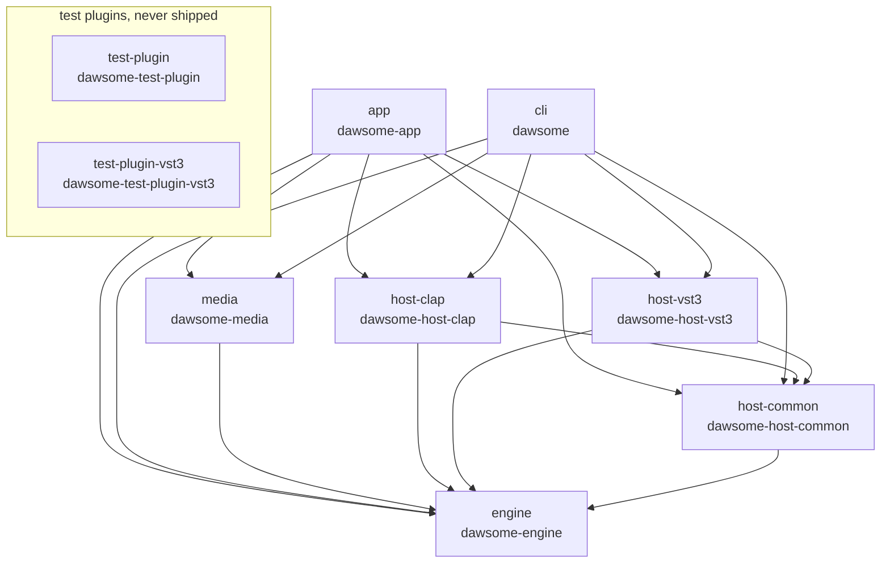

# Architecture

A map of Dawsome's code for someone about to change it: what each crate is for, which crates
depend on which, the libraries underneath, and the rules every change keeps.
[CONTRIBUTING.md](../CONTRIBUTING.md) has the build and the check command, and
[the manual](manual.md) describes the program as a user sees it.

## The program in one paragraph

Dawsome builds two programs from one Cargo workspace. `dawsome-app` is the desktop app (crate
`crates/app`). `dawsome` is the command line (crate `crates/cli`): it renders a project to WAV or
MP3, scans plugins, and imports and exports MIDI files, stems and DAWproject packages. Both stand
on the same lower crates. `engine` holds the document and everything that turns it into sound,
with no files, devices or windows. `media` does everything with files. `host-common`,
`host-clap` and `host-vst3` host CLAP and VST3 plugins. Data moves one way:
`Project` → `edit::apply` → `Compiler` → `PlayPlan` → `Player::process`. The UI thread owns the
one document, a `Project`. Every change is an `Edit`, applied by `edit::apply`, which returns the
inverse for undo. The `Compiler` turns the changed parts into a new, immutable `PlayPlan`. The
plan is moved to the audio thread, where `Player::process` renders it, and the old plan is moved
back and freed on the UI thread. The command line calls the same `Player::process` in a loop to
write a file, so an offline render and live playback run the same code.

## Crates and what each owns

Seven crates ship; the two test-plugin crates exist only for the tests.

| Crate | Package | What it owns | What it must never do |
|-|-|-|-|
| `engine` | `dawsome-engine` | The `Project` document: plain serde data keyed by stable IDs, its validation and its file format. Musical time: integer ticks, the tempo map, time signatures (the project's, a pattern's own in `Pattern.time_signature`, and the changes along the song in `Project.signature_changes`, read through `time::MeterMap`). Edits and undo. The compiler and the play plan. The renderer and the realtime `Player`. Native DSP: the sampler, SFZ instruments, Dawsome Synth and the built-in effects. The SFZ text reader and MIDI files. | Touch a file, a device, a window or a plugin ABI. Hold `unsafe` code (the crate forbids it). Allocate, free, lock or log on the audio thread. |
| `media` | `dawsome-media` | Everything with files: decoding, resampling on load, the sound cache the compiler asks for samples (`MediaSounds`, which implements the engine's `Sounds` trait), disk streaming of long clips, time-stretch, a sound's edits applied, recording to WAV, the WAV and MP3 writers, the offline render loop both programs share, interchange export (the song as MIDI, stems, DAWproject), and finding a project's sound files after it moves. | Make the audio thread wait for the disk: a stream that falls behind plays silence and counts it. Hold `unsafe` code. |
| `host-common` | `dawsome-host-common` | What every plugin format's host shares: the plugin catalogue (one JSON file for both formats), the parent half of the plugin scan (one child process per plugin file, stopped when it stalls), the note schedule a plugin's audio half plays, the render pump, and the plugin windows (X11 on Linux, Win32 on Windows). | Hold a plugin ABI. |
| `host-clap` | `dawsome-host-clap` | The CLAP host: the scan child's half for `.clap` files, plugin instances on the main thread, the audio half the player calls, and a plugin's interface embedded in a `host-common` window. Re-exports `host-common`'s catalogue and scan. | Depend on `host-vst3`. Allocate in the audio half: its buffers and event queue are sized when the instance is made. |
| `host-vst3` | `dawsome-host-vst3` | The VST3 host: module loading, the COM objects a plugin talks to, component and controller lifecycle, the MIDI mapping (pitch bend and the mod wheel), the audio half, `.vstpreset` state, and a plugin's own editor in a window of ours. | Depend on `host-clap`. Make an instance from a module no scan child loaded first. |
| `cli` | `dawsome` | The command line: `render`, `scan`, `smf-import`, `smf-export`, `export-midi`, `export-stems` and `export-dawproject`. It is the entry point the known-answer tests run through. | Render by any path but `Player::process`. Hold `unsafe` code. |
| `app` | `dawsome-app` | The desktop app: the iced windows and panels, the open document with its history and compiler (`src/session.rs`), audio output, audio and MIDI input, the MIDI-out thread, settings, autosave, and reading and writing project files (`src/project_file.rs`). | Do anything in the audio callback but run the player. Read or write a project file outside `src/project_file.rs`. |
| `test-plugin` | `dawsome-test-plugin` | CLAP plugins whose output follows exact formulas (a sine, a gain and variants, one with a logging interface), plus a file that aborts as it loads: the CLAP host's test oracles. | Ship, or depend on a workspace crate. |
| `test-plugin-vst3` | `dawsome-test-plugin-vst3` | VST3 plugins with the same formulas, plus classes that fail, run a timer, report latency or open an editor, and a module that aborts as it loads: the VST3 host's test oracles. | Ship, or depend on a workspace crate. |

`engine`, `media` and `cli` forbid `unsafe` code. Outside the tests, every `unsafe` block in the
workspace is in the plugin hosts and the test plugins. Each block does one operation under a
`// SAFETY:` comment, and lints in each of those crates fail the check on any other kind of
block.

Where a change usually starts:

- **A mixer bug.** The mixer's data is in `crates/engine/src/project/mixer.rs`, its edits in
  `crates/engine/src/edit/mixer.rs`, and the sound it makes in `crates/engine/src/render.rs`. The
  panel is `crates/app/src/ui/mixer.rs`, with its layout and state beside it.
- **A file format change.** `crates/engine/src/project.rs`: the fields, `validate`, the format
  version and `to_json`. The app's `src/project_file.rs` changes only when saving or opening
  itself changes.
- **A plugin crash.** During a scan, `crates/host-common/src/scan.rs` and `child.rs`. Once
  loaded, `crates/host-clap` or `crates/host-vst3`: `host.rs` for the main thread,
  `processor.rs` for the audio half.
- **A window problem.** The app's windows are drawn in `crates/app/src/ui/` and driven from
  `crates/app/src/app.rs` and `crates/app/src/app/`. A plugin's window is `crates/host-common/src/window/`,
  with each format's part in its host crate.
- **A sound file that will not load or play.** `crates/media/src/decode.rs` and `sounds.rs`.

## Who depends on whom

Each arrow reads "depends on" and comes from that crate's `[dependencies]` in its `Cargo.toml`.

Arrows point one way; nothing reaches back up. `engine` depends on no other workspace crate, so
everything that decides what the music sounds like can be built and tested without a device, a
window or a plugin. The two plugin hosts never depend on each other, so one format can change
without touching the other. The test plugins depend on nothing in the workspace: the hosts load
them as built plugin files, the same way they load anyone else's.

Inside the engine the modules run one way too. `time` comes first; `project` builds on it and
`edit` on `project`. `processor` and `dsp` feed `compile`, which builds a `plan`. `render` reads
the plan and the `transport`, and `realtime` wraps `render` in the `Player`.

## Inside the app

Two threads matter. The UI thread runs the iced window and owns the document:
`crates/app/src/session.rs` holds the `Project`, its undo history, the `Compiler`, and the UI half
of the link to the audio thread. The audio thread is the cpal output callback in
`crates/app/src/audio.rs`, and it does one thing: it fills the device's buffer from
`Player::process`. When the device cannot run at the project's sample rate, a `RateBridge`
resamples the player's output inside the callback, still without allocating.

`realtime::link` in the engine makes both halves at once: a `RealtimeLink` for the UI thread
and a `Player` for the audio thread. They share nothing but wait-free single-producer rings and
atomics:

- **The plan ring** carries each new `PlanUpdate`: a boxed `PlayPlan` plus the processors and
  clip sources to add or drop. Updates queue in order and are never merged.
- **The retire ring** carries the replaced plan, removed processors and finished sources back, so
  they are freed on the UI thread. The player swaps to a new plan at the start of a `process`
  call, and only when the retire ring has room.
- **The control ring** carries `Control` messages: Play, Stop, Seek, tempo changes, live
  parameter moves, and the live notes of the computer keyboard and the instrument window.
- **The event ring** carries `EngineEvent`s back: an underrun, a live note started or ended.
  When it is full it drops the event and counts it, so the audio thread never waits.
- **Atomics** carry the position, the playing state and the meters back to the window.
- **MIDI.** Each MIDI input port's thread pushes notes into a lock-free `MidiInbox` that the
  player drains on every call. Notes going out are written to a ring with the output frame they
  belong to, and the app's MIDI-out thread sends each one on time.

Other threads do the slow work: sound loading and waveform workers, the disk stream readers, the
recording writer, the input device's callback, the export worker, and the two runtime workers the
window's background tasks run on. The audio thread never waits on any of them.

Plugins sit behind the same port as the built-in DSP. Every generator and effect is a
`Processor` (`crates/engine/src/processor.rs`): it processes a stereo block, given a
`ProcessContext` with the parameter values, the block's note events and the transport. Built-in
processors come from the engine's `Registry`. Plugins come from a `ProcessorHost`
(`crates/engine/src/processor/host.rs`), which `ClapHost` and `Vst3Host` implement on the UI
thread. The compiler asks a host for an instance, the instance's audio half travels to the player
inside a plan update, and it comes back on the retire ring before the host lets the plugin go.
The engine sees only its own types; a plugin's saved state is an opaque `ProcessorRef` it never
reads.

No plugin is loaded into either program until a scan has loaded it in a child process first
(`dawsome scan --child <file>`, or the app's `--scan-child`). A plugin that crashes or hangs
there takes down only the child, and the catalogue records its file as failed. A plugin's window
is a top-level window of ours from `host-common`: a CLAP interface embeds into it, and a VST3
editor goes into an XEmbed embedder window on Linux.

## Libraries and what each is for

Every direct dependency of the shipped crates, from their `Cargo.toml` files, plus the ones the
test plugins add. "Tests" means the crate's tests use it too, as a dev-dependency.

| Library | Used by | What it is for |
|-|-|-|
| `iced` | app | The windows, widgets and canvases; draws with wgpu, or with tiny-skia in software. |
| `winit` | app (through iced) | Opens the windows and delivers keyboard and pointer input; not a direct dependency. |
| `cpal` | app | Audio devices: the output stream whose callback runs the player, and the input streams a recording reads. On Linux, PipeWire when its server runs, else ALSA. |
| `midir` | app | MIDI ports, in and out: the ALSA sequencer on Linux, WinMM on Windows. |
| `wmidi` | app | Parses each MIDI message a port delivers, without allocating. |
| `rtrb` | engine, media, host-vst3 | Wait-free single-producer rings: between the UI and audio threads, a recording's input ring, the VST3 audio half's rings. |
| `crossbeam-queue` | engine, app | Bounded lock-free queues: the live-note inbox many MIDI threads push into, and the controller moves the window reads. |
| `tokio` | app | The runtime the window's background tasks run on (file dialogs, file work, the timer that serves plugins' main-thread requests), with two workers. |
| `rfd` | app | Native file dialogs, through the desktop portal on Linux. |
| `png` | app | The window icon, the Help window's pictures, and headless screenshots. |
| `raw-window-handle` | app | The main window's X11 id or Win32 handle, to ask where the pointer is when a file is dropped from the desktop. |
| `dirs` | app, media, host-common | The per-user folders: XDG on Linux, AppData and the known folders on Windows. |
| `dunce` | app, media | Resolves paths, in the plain `C:\...` form on Windows that a project can keep. |
| `embed-resource` | app (build) | The Windows program's icon and version details; does nothing for other targets. |
| `symphonia` | media | Decodes WAV, AIFF, FLAC, Ogg Vorbis and MP3, in pure Rust. |
| `rubato` | media, app | Resampling: a sound file to the project's rate once on load, and the player's output to a device's rate. |
| `creek` | media | Streams long audio clips from disk: a reader thread fills a ring the audio thread reads without waiting. |
| `signalsmith-stretch` | media | Time-stretch of audio clips; bundles the Signalsmith Stretch C++ library. |
| `mp3lame-encoder` | media | MP3 export; builds the bundled LAME source into a static library. |
| `hound` | media; tests | Writes WAV renders and recordings; tests read renders back. |
| `sha2` | media; tests | Names converted, stretched and edited sounds in the cache by a hash of what made them; tests hash renders. |
| `base64` | media, host-clap, host-vst3 | A plugin's state as text in the project file, and as bytes in a DAWproject package. |
| `midly` | engine | Standard MIDI files, read and written, without its thread-pool feature. |
| `serde` | engine, host-common, app | The project file, the catalogue and the settings as plain data. |
| `serde_json` | engine, host-common, app, cli | That data as JSON. |
| `thiserror` | engine, media, host-common, app, cli | Error types. |
| `clack-host` | host-clap | The CLAP ABI, host side. |
| `clack-extensions` | host-clap, test-plugin | CLAP extensions: audio and note ports, GUI, latency, parameters, state, timers, file descriptors, thread checks. |
| `clack-plugin` | test-plugin | The CLAP ABI, plugin side. |
| `vst3` | host-vst3, test-plugin-vst3 | Rust bindings to the VST 3 SDK's interfaces. |
| `libloading` | host-vst3; tests | Loads a VST3 module's binary. |
| `libc` | host-common, host-clap, host-vst3 | On Unix: a scan child's process group, `poll` for the file descriptors plugins register, and module loading flags. |
| `x11rb` | host-common, test-plugin, test-plugin-vst3; tests | Plugin windows on X11, with the XEmbed embedder for VST3 editors; the test plugins' editors. |
| `windows-sys` | host-common | On Windows: a scan child's job object, and the Win32 plugin windows. |
| Airwindows Pressure4 and Density (ported code) | engine | The compressor and the saturator, ported from Airwindows under the MIT license and tested against renders of the originals; source and license in [licenses/THIRD_PARTY.md](../licenses/THIRD_PARTY.md). |

The license text of every library built into the programs is in `licenses/NOTICES.txt`. A new
dependency under a license other than MIT or Apache-2.0 also gets a row in
`licenses/THIRD_PARTY.md`; CONTRIBUTING.md says how the license check holds both.

## Invariants a change must keep

1. **Integer musical time.** Positions are integer ticks (96 per quarter note in every project the
   app makes) and tempo is integer milli-BPM: 120 BPM is `MilliBpm(120_000)`. No float time is
   stored or added up. A time signature changes how ticks group into beats and bars, never what a
   tick is: a step is always a 16th note and tempo always counts quarter notes.
2. **One tick-to-sample function.** `time::tick_to_sample` computes
   `floor(tick · 60 · sample_rate · 1000 / (milli_bpm · ppq))` in u128 integer math, from the
   absolute tick, every time. Every conversion goes through it. Why: a cached float "samples per
   tick" rate lands one sample early on exact boundaries (at 174.5 BPM and 48 kHz, tick 48511 is
   sample 8340000, and the cached rate says 8339999). That case is a test.
3. **Block-size invariance.** `Player::process` gives bit-identical output however its buffer is
   split: one block, blocks of 1, primes, 4096, seeded random sizes, across loop wraps and the
   song's end. Events are placed by absolute sample and nothing is added up per block. Why: the
   device's buffer size cannot change the sound, so what plays live is what an offline render
   proves. Third-party plugins are the one exception, by their nature.
4. **An allocation-free audio thread.** The audio thread never allocates, frees, locks or logs.
   Plans and processors arrive whole and leave on the retire ring, and every buffer is sized
   before it gets there. A counting-allocator test around `Player::process` and the rate bridge
   proves it. Why: one blocking call is an audible glitch.
5. **Known answers come from generators.** Expected values in tests (sample positions, levels,
   documents, file bytes) come from the Python generators in `tests/fixtures/`, standard library
   only and run with `python3 -I`, never from running the engine. A deliberate change in
   behavior regenerates the fixtures from their generator; an expected value is never edited by
   hand. Why: a renderer tested against its own output stays green while wrong.
6. **Tests never write the user's folders.** Tests and scripted runs never write the user's
   settings, caches or data. They pass `--cache`, `--cache-dir`, `--plugin-path` and temporary
   `XDG_*` folders. Why: running the checks must leave the machine as it found it.
7. **Canonical JSON.** `Project::to_json` writes the format version first, then the document's
   fields in a fixed order: channels and patterns by ID, notes by tick, channel and key. Equal
   projects give identical bytes, so a save, an undo or a round trip can be compared byte for
   byte. The app saves atomically: a temporary file, then a rename.
8. **Stable IDs.** Channels, patterns and the other objects of the document have IDs that are
   never reused, and everything refers to them by ID. Dense indices exist only inside a compiled
   plan, and the player reuses a slot only after its retire came back. Why: undo, the links
   between clips and patterns, and older files all stay correct.
9. **The format-version rule.** A project file records the lowest `format_version` that holds
   what the document uses. A project that uses nothing new keeps its version and its bytes. A
   field an older build would misplay, or drop when it saves, gets a new version, so that build
   refuses the file by its number instead of damaging it. Older versions still open, migrated on
   load; an unknown version is refused with a message naming the ones this build reads. Time
   signatures are the latest example: a project in 4/4 throughout writes none of their fields
   and keeps its version.
10. **Processors behind one port.** Every generator and effect, built-in or plugin, is a
    `Processor` the player drives the same way. Plugin ABIs live only in `host-clap` and
    `host-vst3`. A plugin's state is an opaque `ProcessorRef` that round-trips byte for byte even
    when the plugin is missing: a missing instrument plays silence and a missing effect passes
    its audio through. A new built-in effect is one type implementing `Processor` and a factory
    in the native `Registry`; the two Airwindows ports in `crates/engine/src/dsp/airwindows/`
    are worked examples.

## Where to start reading

1. `crates/engine/src/lib.rs`: the engine's modules and the one-way flow, in a dozen lines.
2. `crates/engine/src/project.rs`: the document, its validation, the format versions and
   canonical JSON.
3. `crates/engine/src/realtime.rs`: the boundary between the UI thread and the audio thread,
   and `Player::process`.
4. `crates/cli/src/main.rs`: the whole path in one program; `render` loads a project, compiles
   it and runs the player into a file.
5. `crates/app/src/session.rs`: how the app holds the open document and sends each edit's plan
   to the audio thread.

## How to check a change

[CONTRIBUTING.md](../CONTRIBUTING.md) has the details; in short:

- `scripts/check.sh` runs the license checks, every known-answer generator in its `--check`
  mode, the format check, clippy with warnings as errors and every test. It must pass before a
  pull request.
- `scripts/ui-check.sh` takes headless screenshots of each panel and plugin window and checks
  them pixel by pixel. Run it after changing anything you can see; it needs a graphical session.
- The generators, `tests/fixtures/gen_*_expected.py`, write the known answers. When behavior
  changes on purpose, run the generator and commit what it writes alongside the code.
